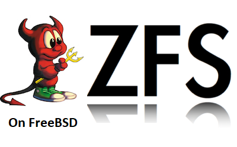

# FreeBSD 中的 ZFS 支持



## 在 FreeBSD 中安装 OpenZFS

OpenZFS 以预打包形式提供：

* zfs-2.0-release 分支，从 FreeBSD 13.0-CURRENT 开始内置在 FreeBSD 基本系统中
* master 分支，从 FreeBSD 12.1 开始在 FreeBSD Ports 中提供，路径为 `sysutils/openzfs` 和 `sysutils/openzfs-kmod`

本文档的其余部分将说明如何使用 OpenZFS，无论是通过 Ports/pkg 安装，还是从源码手动构建以用于开发。

ZFS 工具将安装在 `/usr/local/sbin/`，请确保相应地调整你的路径。

要在启动时加载模块，请在 `/boot/loader.conf` 中加入 `openzfs_load="YES"`，如果要迁移已有的 ZFS 安装，请删除 `zfs_load="YES"`。

> **注意**
>
>FreeBSD 引导加载程序不支持从启用加密的根存储池中启动（即使并未实际使用加密），因此不要对你从中启动的存储池使用加密。

## 在 FreeBSD 上开发 OpenZFS

在 FreeBSD 上构建 OpenZFS 需要以下依赖：

* FreeBSD 源码，位于 `/usr/src` 或通过环境变量 `SYSDIR` 来指定的其他路径。如果尚未安装源码，可以用 git 安装：

  FreeBSD 12 源码：

  ```bash
  git clone -b stable/12 https://git.FreeBSD.org/src.git /usr/src
  ```

  FreeBSD-CURRENT 源码：

  ```bash
  git clone https://git.FreeBSD.org/src.git /usr/src
  ```

* 构建所需软件包：

  ```bash
  pkg install \
      autoconf \
      automake \
      autotools \
      git \
      gmake
  ```

* 可选构建软件包：

  ```bash
  pkg install python
  pkg install devel/py-sysctl  # 用于 arcstat、arc_summary、dbufstat
  ```

* 测试与检查软件包：

  ```bash
  pkg install \
      base64 \
      bash \
      checkbashisms \
      fio \
      hs-ShellCheck \
      ksh93 \
      pamtester \
      devel/py-flake8 \
      sudo
  ```

  你可以将其替换为你首选的 Python 版本。运行测试的用户必须拥有 NOPASSWD 的 sudo 权限。

构建与安装方法：

```bash
# 以普通用户身份
git clone https://github.com/openzfs/zfs
cd zfs
./autogen.sh
env MAKE=gmake ./configure
gmake -j$(sysctl -n hw.ncpu)

# 以 root 身份
gmake install
```

要在 FreeBSD 启动时加载 OpenZFS 内核模块，请编辑 `/boot/loader.conf`：

将以下行：

```ini
zfs_load="YES"
```

替换为：

```ini
openzfs_load="YES"
```

FreeBSD 自带的 ZFS 二进制文件安装在 `/sbin`，通过 Ports/pkg 或从源码手动安装的 OpenZFS 二进制文件安装在 `/usr/local/sbin`。要使用 OpenZFS 二进制文件，请将 `/usr/local/sbin` 放在 `/sbin` 之前，否则系统将使用原生的 ZFS 二进制文件。

例如，将 `~/.profile`、`~/.bashrc`、`~/.cshrc` 中的 PATH 从：

```ini
PATH=/sbin:/bin:/usr/sbin:/usr/bin:/usr/local/sbin:/usr/local/bin:~/bin
```

修改为：

```ini
PATH=/usr/local/sbin:/sbin:/bin:/usr/sbin:/usr/bin:/usr/local/bin:~/bin
```

在快速开发环境中，使用 UFS 进行安装而非 ZFS 可能更方便，这样可以在无需重启的情况下卸载或加载 ZFS 模块：

```bash
reboot
```

虽非必需，但在 FreeBSD 构建中使用选项 `WITHOUT_ZFS` 可以避免构建和安装旧版的 ZFS 工具及 kmod——参见 `src.conf(5)`。

某些测试需要在 `/dev/fd` 上挂载 fdescfs，可临时执行：

```bash
mount -t fdescfs fdescfs /dev/fd
```

或者在 `/etc/fstab` 中添加条目：

```sh
fdescfs /dev/fd fdescfs rw 0 0
```
